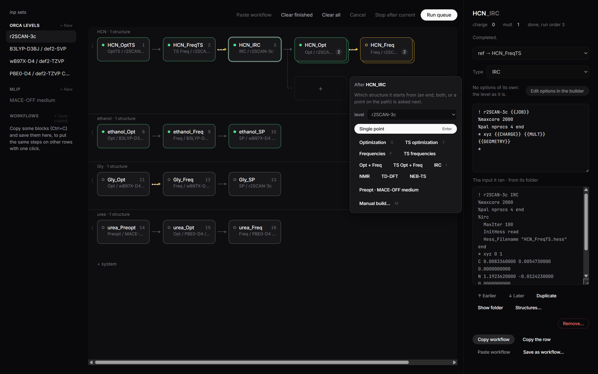
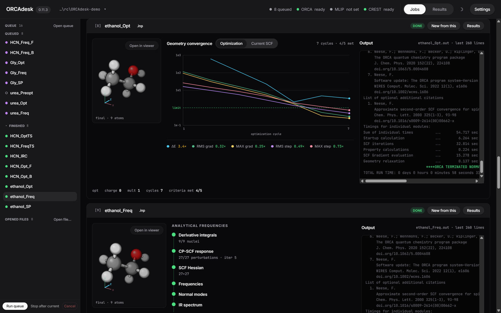
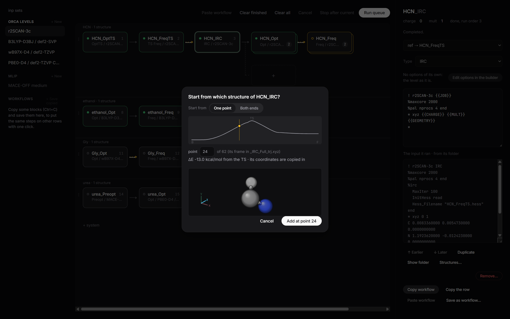
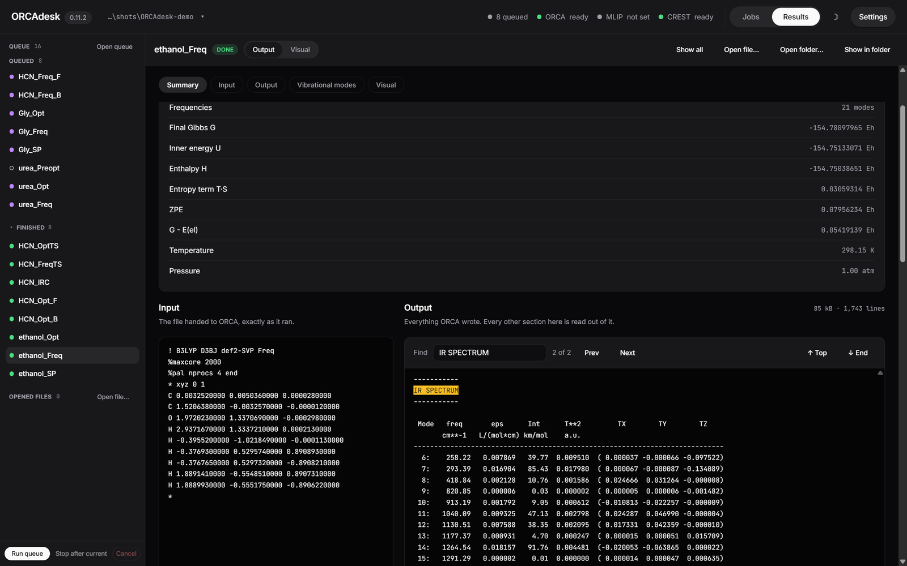
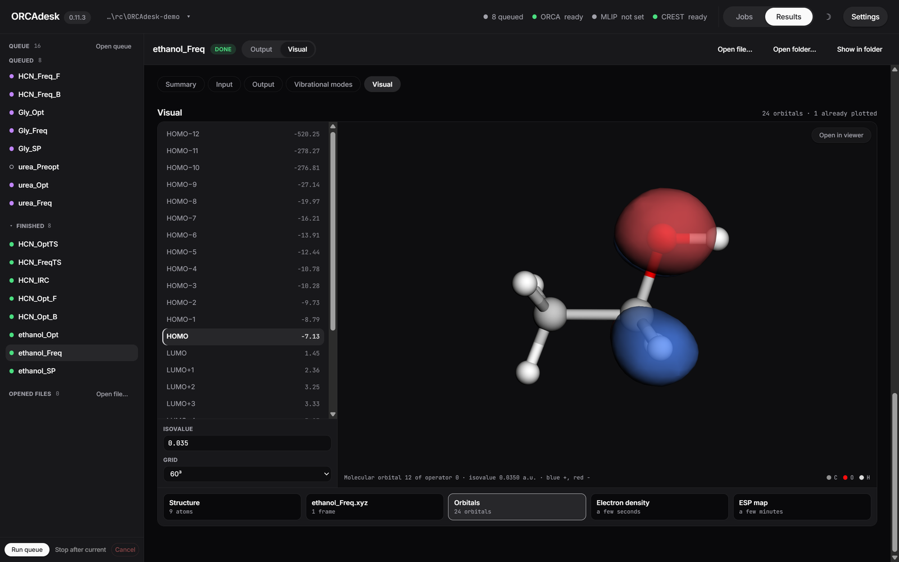

<p align="center">
  
</p>

<h1 align="center">ORCAdesk</h1>

<p align="center">
  <b><a href="https://www.faccts.de/orca/">ORCA</a> 계산을 만들고, 큐에 넣고, 돌리고, 읽는 데스크톱 앱.</b><br>
  TS → IRC → 양 끝 Opt / Freq → SP 같은 연구 흐름 전체를 여러 분자에 한 번에
  걸어 두고, 계산이 수렴하는 모습을 실시간으로 보고, 결과까지 앱 안에서
  확인합니다.
</p>

<p align="center">
  <a href="https://github.com/wtbdkim/OrcaDesk/releases"></a>
  
  
  
  <a href="LICENSE"></a>
</p>

<p align="center">
  <a href="#설치">설치</a> ·
  <a href="#빠른-시작">빠른 시작</a> ·
  <a href="#주요-기능">주요 기능</a> ·
  <a href="CHANGELOG.md">변경 내역</a> ·
  <a href="README.md">English</a>
</p>

<p align="center">
  
</p>

> **현재 버전: 0.11.3** (베타). 실제 ORCA 6.1.1 출력으로 검증했습니다.
> ORCAdesk는 ORCA 개발진, FACCTs, 어떤 기관과도 관계없는 개인 프로젝트이며 ORCA를
> 포함하지 않습니다. 직접 설치한 `orca`를 실행합니다(학술용 무료).

## 왜 ORCAdesk인가

- **여러 분자에 연구 흐름을 통째로.** 큐 창에서 분자 하나가 한 줄이고, 줄마다
  계산 단계가 블록으로 이어집니다. `.xyz` 파일을 한꺼번에 끌어다 놓고, **+**로
  다음 단계를 붙이고, 한 줄의 흐름을 다른 줄에 복사해 붙여 넣습니다. 비싼
  단계는 승인할 때까지 기다리게 할 수 있습니다.
- **전이 상태 연구에 맞춰서.** IRC 다음 단계를 붙이면 그 IRC의 에너지 곡선이
  뜹니다. 한쪽 끝, 양쪽 끝, 경로 위 아무 지점이든 골라서 이어 갑니다.
- **걸어 두고 자리를 떠도 되는 실행.** 허용한 코어·메모리 안에서 여러 계산을
  동시에 돌리고, 앞 단계가 끝나는 대로 다음 계산을 시작합니다. 앱을 닫아도
  ORCA·CREST 계산은 계속 돌고, 다시 켜면 이어서 따라갑니다. 하나가 실패해도
  그 결과를 쓰는 단계만 멈춥니다.
- **실시간 진행 상황.** SCF와 최적화 수렴 조건 다섯 가지를 그래프로 보여 주고,
  진동수·TD-DFT 계산은 ORCA의 실제 단계별로 진행을 표시합니다. 남은 시간은
  얼마나 확실한지와 함께 보여 줍니다.
- **읽기 쉬운 결과.** 에너지, 오비탈, 전하, 결합 차수, 진동수, 열화학, UV-Vis,
  NMR을 정리해 보여 주고, 오비탈·전자 밀도·ESP를 3D로 그립니다.
- **ORCA가 한 번에 받아들이는 입력.** 계산 전에 구조를 검사하고(불가능한 다중도,
  겹친 원자, Bohr 단위 좌표), `.inp`에는 ORCA 기본값과 다른 것만 씁니다.
- **DFT 너머까지.** MACE 기계 학습 퍼텐셜로 미리 최적화하거나 CREST로 형태 이성질체
  (conformer)를 찾고, 그 구조를 같은 큐에서 ORCA 계산으로 넘깁니다.

## 스크린샷

| | |
|---|---|
|  |  |
| **메인 창**: 왼쪽의 큐 목록, 그리고 계산마다 실시간 수렴 그래프와 출력. | **IRC 다음 단계**: IRC 에너지 곡선에서 이어 갈 구조를 고릅니다. |
|  |  |
| **결과**: IR 스펙트럼으로 그린 진동 모드. 봉우리를 누르면 그 진동이 구조 위에서 움직입니다. | **3D**: 끝난 계산의 파동 함수로 그린 오비탈·전자 밀도·ESP. |

## 설치

**ORCA 6.x**가 필요합니다([faccts.de/orca](https://www.faccts.de/orca/), 학술용
무료). 처음 실행할 때 ORCAdesk가 ORCA를 찾아보고, 못 찾으면 **Settings → ORCA
executable**에서 `orca.exe`를 지정하면 됩니다.

**Windows 설치 파일.** [Releases](https://github.com/wtbdkim/OrcaDesk/releases)에서
`ORCAdesk-<버전>-Setup.exe`를 받아 실행합니다. 설정과 작업 폴더 정보는 사용자마다
`%APPDATA%\ORCAdesk`에 저장되므로 업데이트해도 그대로 남습니다.

**소스에서 실행 (Windows, Linux)** — Python 3.10 이상:

```bash
git clone https://github.com/wtbdkim/OrcaDesk.git
cd OrcaDesk
pip install -r requirements.txt   # PyQt6, PyQt6-WebEngine, psutil, numpy
python main.py
```

Windows 10/11에서 시험했고, 설치 파일도 Windows용만 있습니다. Linux는 소스에서
실행하며 CREST도 됩니다. macOS는 시험하지 않았습니다.

## 빠른 시작

1. ORCAdesk를 켜고 **Settings**(상단 톱니바퀴)에서 ORCA 경로, 작업 폴더,
   큐가 쓸 코어 수와 메모리를 확인합니다.
2. **Open queue**를 누르고 `.xyz` 파일들을 창에 끌어다 놓습니다. 분자마다 한
   줄이 생깁니다. 주석 줄에 `charge=1 mult=2`처럼 적혀 있으면 전하와 다중도도
   읽어 옵니다.
3. 줄 옆의 **+**를 누릅니다. 메뉴가 다음 단계와 계산 수준을 제안하므로(Enter로
   추가) Opt → Freq가 두 번 클릭이면 됩니다. Ctrl+C / Ctrl+V로 한 줄의 흐름을
   다른 줄에 복사합니다.
4. **Run**을 누릅니다. 메인 창 **Jobs**에서 진행을 보고, 끝난 계산은
   **Results**에서 보고서로 엽니다.

계산 수준은 **inp set**으로 저장해 둡니다. `{{JOB}}` 자리에 작업 키워드가 들어가는
ORCA 입력 전체라서, 수준 하나를 모든 계산 종류에 쓸 수 있습니다. 큐 창의
라이브러리에서 편집합니다.

## 주요 기능

### 큐 창

- **줄(분자)**: `.xyz`를 여러 개 한 번에 끌어다 놓으면 각각 한 줄이 됩니다.
  Ctrl+클릭으로 여러 줄을 골라 붙여 넣기나 전하 설정을 한 번에 합니다.
- **계산 수준(inp set)**: 라이브러리의 ORCA 수준이나 MLIP 설정을 블록에 끌어다
  놓으면 수준만 바뀌고 계산 종류는 그대로입니다. CREST 설정을 줄에 놓으면
  conformer 탐색 블록이 되고, 그 뒤 단계는 conformer 여러 개를 한 번에(`_c1 … _cK`)
  받을 수 있으며 화살표에 에너지 조건(ΔE ≤ X kcal/mol · 상위 N개)을 걸면 조건에
  못 미친 것은 돌지 않고 **Filtered**로 끝납니다.
- **단계 추가**: 블록 옆 **+** 메뉴에 자연스러운 다음 단계(Enter), 다른 계산
  종류, MLIP 사전 최적화, 저장한 워크플로, 직접 만들기(*Manual build…*)가
  있습니다. 아직 돌지 않은 블록을 고르면 들어오는 화살표 위에도 **+**가 생겨서
  그 앞(두 블록 사이 포함)에 단계를 끼워 넣을 수 있습니다. 새 단계 이름은
  `<줄 이름>_<작업>`(`mol_Opt`, `mol_FreqTS` …)입니다.
- **IRC 다음 단계**: IRC 에너지 곡선에서 정방향·역방향 끝, 경로 위 한 지점,
  또는 양 끝을 한 번에(`_F` / `_B` 한 쌍) 고릅니다. ← / →로 지점을 옮깁니다.
- 연결마다 **승인 후 진행**을 걸 수 있고, 한 줄의 단계들을 복사·붙여 넣거나
  이름을 붙여 **워크플로**로 저장합니다. Ctrl+Z로 되돌립니다.
- 큐는 **실행 중에도 편집**됩니다. 끝난 단계는 고정되고 실패한 단계는 잠기지만,
  새 수준을 넣으면 덮어쓰기 경고 뒤에 **다시 계산**합니다(실패한 단계 때문에
  막혀 있던 뒤 단계도 함께 이어서 돕니다). 단계를 지워도 큐에서만 빠지고
  폴더는 디스크에 남습니다.

### 계산 만들기

- DFT(ORCA), MLIP, CREST 중에서 고릅니다. DFT는 **Guided**(입력 양식)와 **.inp
  text**(입력 전체를 직접 편집) 두 가지 방식이 있습니다.
- 계산 종류: Opt, Opt + Freq, TS Opt, TS Opt + Freq, Freq, TS Freq, NEB-TS, IRC,
  TDDFT, NMR, SP, General.
- 구조는 `.xyz` 파일에서 가져오거나, 큐에 있는 다른 계산의 최종 구조를 실행할 때
  받아 씁니다. 불러온 구조는 3D로 그리고 계산 전에 검사합니다. 구조를 대신
  고치지는 않습니다.
- 제약 조건과 relaxed surface scan은 구조 위에서 원자를 찍어 지정하고, 진동
  모드를 따라 구조를 밀어 볼 수 있습니다.

### 실행과 결과

- 앞 단계가 끝나는 대로, 설정한 예산(동시 계산 수, 전체 코어, 전체 메모리)
  안에서 여러 계산을 동시에 돌립니다. 큐는 자동 저장되고 다음 실행 때
  복원됩니다.
- 결과 보고서는 **Output**(요약, 최종 구조, 오비탈 에너지, 전하, 결합 차수,
  IR 스펙트럼과 진동 애니메이션, 열화학, UV-Vis, NMR, NEB 경로, scan, `.out` 전체와
  찾기)과 **Visual**(구조, 궤적, 오비탈, 전자 밀도, ESP 3D)로 나뉩니다.

### MLIP와 CREST

- **MLIP(MACE)**: 구조 최적화, 단일점 에너지, 열화학을 포함한 진동수 계산.
  **Settings → MLIP environments**에서 *Create*를 누르면 CPU용(~150 MB)이나
  GPU/CUDA용(~2.5 GB) 전용 Python 환경을 만들어 줍니다.
- **CREST**: xTB로 형태 이성질체를 탐색합니다. Windows에서는 WSL로, Linux에서는
  바로 실행합니다. 다음 계산은 에너지가 가장 낮은 이성질체로 시작하고, 모든
  이성질체는 각각 `.xyz`로 저장됩니다.

## ORCAdesk가 대신 내려받거나 설치하는 것

요청하기 전에는 아무것도 내려받지 않습니다. 아래 세 동작만 제3자 소프트웨어를
받아 오며, 각각 자체 라이선스를 따릅니다. ORCAdesk가 재배포하는 것이 아니라,
사용자의 컴퓨터가 아래 원 배포처에서 직접 받습니다.

- **Settings → MLIP environments → Create**: pip로 Python 환경을 만듭니다.
  **PyTorch**(BSD-3-Clause, GPU 빌드에는 NVIDIA 자체 약관을 따르는 CUDA
  라이브러리도 포함)는 download.pytorch.org에서, **mace-torch**(MIT) 또는
  **SevenNet**(`sevenn`, MIT)과 그 의존성(ASE는 LGPL-2.1 이상 등)은 PyPI에서
  받습니다. 버전은 pip가 고르는 최신 버전입니다.
- **MACE 모델 가중치**: 모델을 처음 실행할 때 mace-torch가 모델 저자들의
  GitHub에서 받아 `~/.cache/mace`에 저장합니다. 가중치마다 라이선스가 따로
  있으며, 빌더의 모델 목록에 함께 표시됩니다. MACE-OFF(small/medium/large,
  기본값은 MACE-OFF medium), MACE-OMOL extra-large, MACE-MH-1(omol 헤드 포함)은
  [ASL](https://github.com/gabor1/ASL), MACE-MP-0(small/medium/large)은 MIT입니다.
  **ASL은 학술·비상업적 사용만 허용**하며, 상업적 사용에는 모델 저자들의 별도
  라이선스가 필요합니다. 출처는 [README.md](README.md#what-orcadesk-downloads-or-installs-for-you)에 있습니다.
- **Settings → CREST → Install CREST**: [github.com/crest-lab/crest](https://github.com/crest-lab/crest)에서
  **CREST 3.0.2**를 받아 SHA-256을 확인한 뒤에만 `~/.local/opt/crest`(Windows에서는
  WSL 배포판 안)에 풉니다. CREST는 LGPL-3.0이며, 그 안에 들어 있는 xTB
  방법(tblite)도 LGPL-3.0입니다. 별도의 `xtb` 프로그램은 설치하지 않습니다.

이 모델들과 CREST를 쓴 연구에서는 해당 문헌을 인용해 주세요.

ORCAdesk는 **원격 측정(telemetry)을 보내지 않고** 업데이트 확인도 하지 않습니다.
위의 내려받기 외에는 네트워크를 쓰지 않습니다. 창에는 앱에 함께 들어 있는 페이지만
표시되고, 휴대폰 연동 서버(배포판에는 없음)는 소스에서 직접 실행할 때만 동작합니다.

## 한계

- ORCAdesk는 **베타**입니다. 파서와 입력 생성은 ORCA 6.1.1 출력으로
  검증했으며, 다른 ORCA 버전은 출력 형식이 다를 수 있습니다.
- 휴대폰 연동은 개발 중이며 배포판에는 들어 있지 않습니다.

## 기여

버그 신고, 잘못 읽히는 ORCA 출력, 아이디어 모두 환영합니다.
[CONTRIBUTING.md](CONTRIBUTING.md)를 참고해 주세요.

## 라이선스

MIT License, Copyright (c) 2026 Taewoo Kim. [LICENSE](LICENSE)를 참고하세요.
ORCAdesk는 개인 프로젝트이며, 어떤 기관도 만들거나 보증하거나 지원하지 않습니다. 함께 배포되는 글꼴(Inter, JetBrains Mono)과
3Dmol.js의 라이선스는 [README.md](README.md#license)에 적혀 있습니다.

**Windows 설치 파일은 소스와 라이선스가 다릅니다.** 설치 파일에는 PyQt6(GPL-3.0),
Qt와 Qt WebEngine(LGPL-3.0, 그 안의 Chromium 구성 요소는 각자의 라이선스), Python 등
제3자 소프트웨어가 함께 들어 있습니다. PyQt6가 GPL-3.0이므로 설치 파일 전체는 GNU GPL v3로
배포되며, ORCAdesk 자체 코드는 그대로 MIT입니다([LICENSE-BINARY.txt](LICENSE-BINARY.txt)).
포함된 구성 요소의 버전·라이선스·저작권 표시는 [THIRD_PARTY_NOTICES.txt](THIRD_PARTY_NOTICES.txt)에,
라이선스 전문은 [licenses/](licenses/)에 있고, 설치하면 둘 다 `ORCAdesk.exe` 옆에 놓입니다.
설치 파일의 대응 소스는 해당 릴리스 태그의 이 저장소(0.11.3은
[`v0.11.3`](https://github.com/wtbdkim/OrcaDesk/tree/v0.11.3), `build.spec`과 `installer.iss` 포함)와
PyPI의 PyQt6 소스, [download.qt.io](https://download.qt.io/archive/qt/6.11/6.11.1/)의 Qt 6.11.1 소스입니다.
