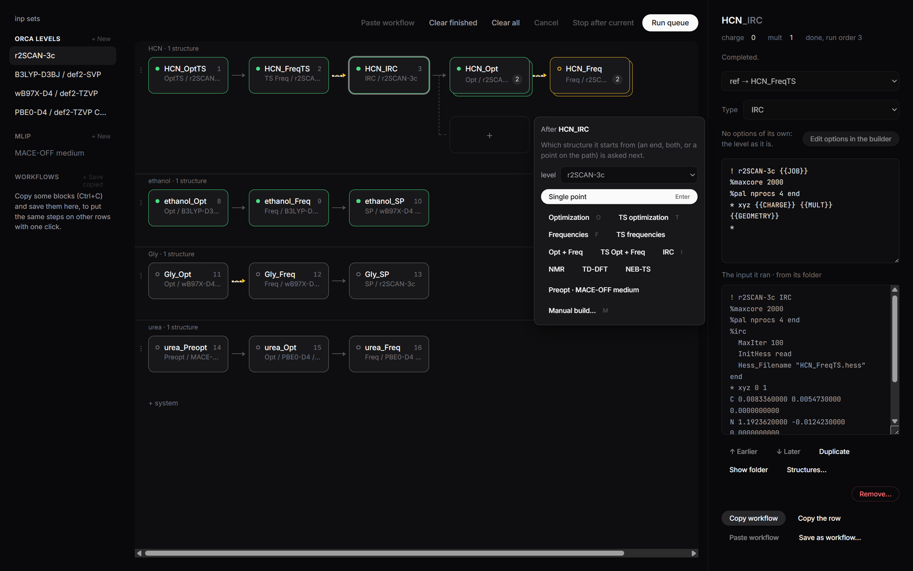
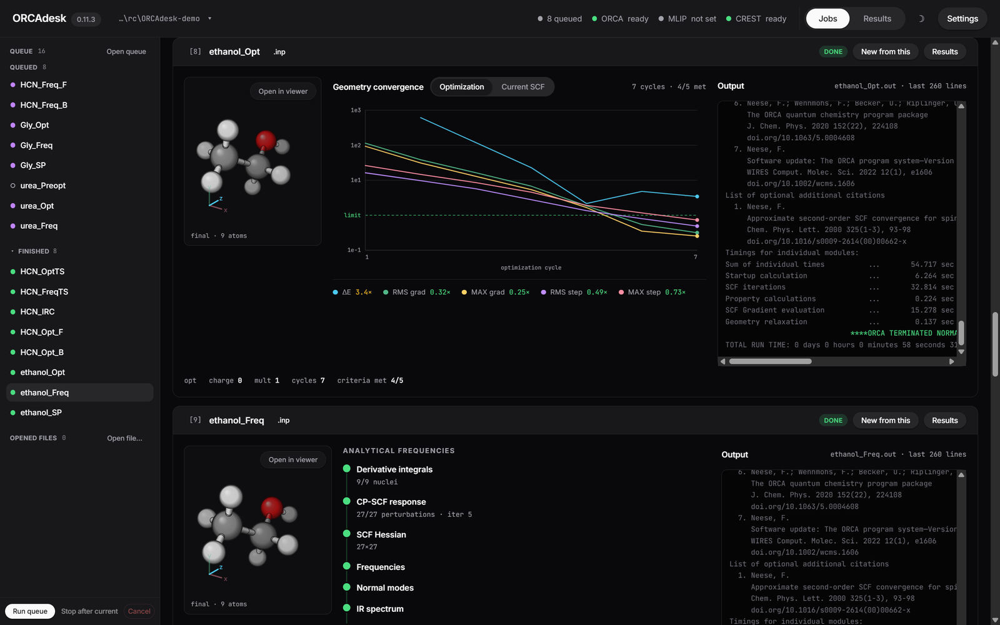
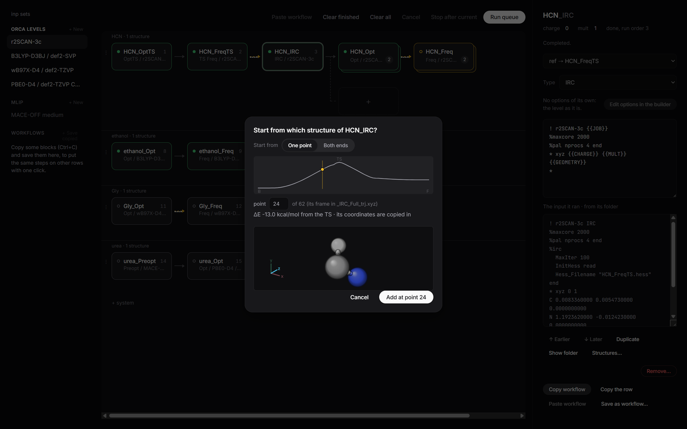
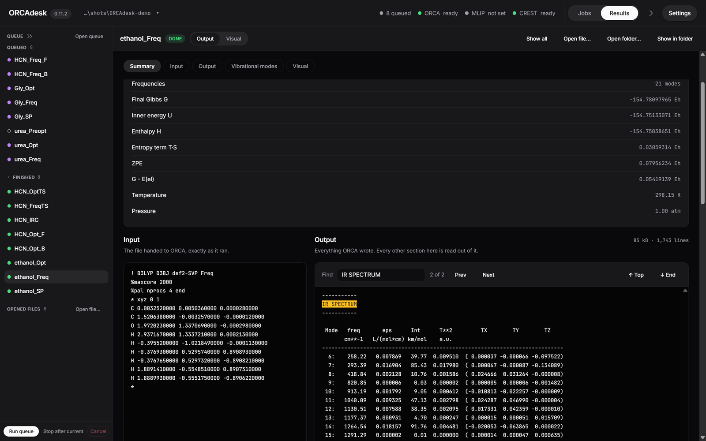
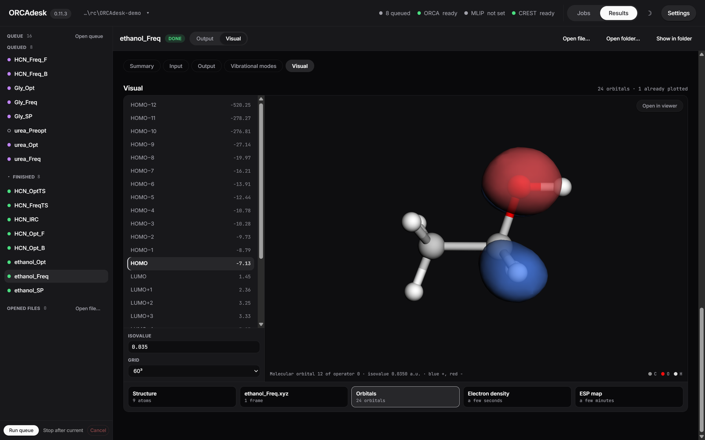

<p align="center">
  
</p>

<h1 align="center">ORCAdesk</h1>

<p align="center">
  <b>A desktop app for building, queuing, running and reading
  <a href="https://www.faccts.de/orca/">ORCA</a> calculations.</b><br>
  Chain a whole study (TS → IRC → end-point Opt / Freq → SP) over many
  molecules at once, watch every job converge live, and read the results
  without leaving the app.
</p>

<p align="center">
  <a href="https://github.com/wtbdkim/OrcaDesk/releases"></a>
  
  
  
  <a href="LICENSE"></a>
</p>

<p align="center">
  <a href="#install">Install</a> ·
  <a href="#quick-start">Quick start</a> ·
  <a href="#features">Features</a> ·
  <a href="CHANGELOG.md">Changelog</a> ·
  <a href="README.ko.md">한국어</a>
</p>

<p align="center">
  
</p>

> **Status: 0.11.2** (`0.11.2`, beta), validated against real ORCA 6.1.1
> output. ORCAdesk is an independent, personal project, not affiliated with
> the ORCA developers, FACCTs or any institution, and it does not include ORCA:
> it drives the `orca` you install yourself (free for academic use).

## Why ORCAdesk

- **Whole workflows, many molecules.** Each molecule is a row of steps in the
  queue window. Drop a batch of `.xyz` files, press **+** for the next step,
  copy a chain onto every row, and hold the expensive steps until you approve
  them.
- **Built for transition-state work.** After an IRC, pick the structure to go
  on from on the IRC's own energy profile: either end, both ends at once, or
  any point along the path.
- **Runs you can walk away from.** Several jobs run at once within the cores
  and memory you allow, each as soon as what it depends on has finished.
  Closing the app never kills an ORCA or CREST job; it is reattached on the next
  launch. A failure holds back only the steps that depend on it.
- **Live progress.** SCF and all five optimization criteria as they converge,
  stage panels for frequency and TD-DFT runs, and time estimates that say how
  sure they are.
- **Results you can read.** Energies, orbitals, charges, bond orders,
  frequencies, thermochemistry, UV-Vis and NMR, plus orbitals, densities and
  ESP maps in 3D.
- **Inputs ORCA takes the first time.** Structures are screened before they
  cost a run (impossible multiplicities, overlapping atoms, coordinates in
  Bohr), and the generated `.inp` writes only what differs from ORCA's own
  defaults.
- **Beyond DFT.** Pre-optimize with a MACE machine-learned potential, or run a
  CREST conformer search, and hand the geometry on to ORCA in the same queue.

## Screenshots

| | |
|---|---|
|  |  |
| **Main window**: the queue strip, and every job as a cell with its live convergence and output. | **After an IRC**: choose the structure to continue from on the IRC's energy profile. |
|  |  |
| **Results**: the summary the parser read (thermochemistry here) beside the input and the whole output, searchable. | **3D**: orbitals, densities and ESP maps from the finished wavefunction. |

## Install

You need **ORCA 6.x** ([faccts.de/orca](https://www.faccts.de/orca/), free for
academic use). ORCAdesk looks for it on first launch; if it is not found, point
**Settings → ORCA executable** at your `orca.exe` (or `orca` on Linux).

**Windows installer.** Download `ORCAdesk-<version>-Setup.exe` from
[Releases](https://github.com/wtbdkim/OrcaDesk/releases) and run it. Settings
and workspaces are kept per user in `%APPDATA%\ORCAdesk`, so they survive
updates.

**From source (Windows or Linux)**, with Python 3.10+:

```bash
git clone https://github.com/wtbdkim/OrcaDesk.git
cd OrcaDesk
pip install -r requirements.txt   # PyQt6, PyQt6-WebEngine, psutil, numpy
python main.py
```

Windows 10/11 is the tested platform and the only packaged one. Linux runs from
source, CREST included. macOS is untested.

## Quick start

1. Launch ORCAdesk and open **Settings** (the gear in the top bar): check the
   ORCA path, your workspace folder, and how many cores and how much memory
   the queue may use.
2. Press **Open queue** and drop your `.xyz` files on the window: one row per
   molecule. A comment line such as `charge=1 mult=2` sets the charge and
   multiplicity.
3. Press **+** beside a row. The menu suggests the next step (Enter adds it)
   and the level to run it at, so Opt → Freq is two clicks. Ctrl+C / Ctrl+V
   copies a chain onto other rows.
4. Press **Run**. Follow the jobs under **Jobs** in the main window; a finished
   one opens as a report in **Results**.

Levels of theory are kept as **inp sets**: a whole ORCA input with `{{JOB}}`
where the job keyword goes, so one level serves every step type. They are
edited in the queue window's library.

## Features

### Queue window

*Open queue* opens the queue as a graph: one **row per molecule**, its steps
chained left to right as blocks (Opt → Freq → IRC → SP …), each drawn in its
state's colour.

- **Rows**: drop `.xyz` files onto the window (several at once) and each
  becomes a row, with its charge and multiplicity read from the comment line
  when it gives them. Ctrl+click row names to select several: one paste or one
  charge then goes on all of them.
- **Inp sets**: the library holds your ORCA **levels** and MLIP sets. Drop one
  on a block to change its level (its type stays), or click one while a block
  is selected.
- **Adding steps**: the **+** beside a block opens a small menu: the natural
  next step (Enter), every other step type, an MLIP pre-optimization, your
  workflows, and *Manual build…* for the full builder. A selected block that
  has not run yet also shows a **+** on its incoming arrow, which puts a step
  in front of it (between two blocks, too). New steps are named
  `<row>_<Job>` (`mol_Opt`, `mol_FreqTS`, …).
- **After an IRC**, adding a step first shows the IRC's **energy profile**:
  take its forward or backward end, any point along the path, or both ends at
  once (an `_F` / `_B` pair drawn as one stacked block). ← / → step through
  the points.
- A connection can wait for your **approval** before the next step runs. A
  row's steps can be copied (Ctrl+C) and pasted onto other rows (Ctrl+V), or
  kept by name as a **workflow**. Ctrl+Z undoes.
- The queue is **live**: steps can be added, edited and reordered while it
  runs. A finished step is frozen and a failed one locked, but putting a new
  level on either **runs it again** after an overwrite warning (its old output
  is replaced; a failed step's blocked follow-ups run after it). Removing a
  step only takes it off the queue; its folder stays on disk.

### Building a calculation

The builder makes one calculation at a time, starting from the backend:
**DFT** (ORCA), **MLIP** or **CREST** (MLIP and CREST appear once they are set
up, so a plain ORCA install sees DFT alone).

- DFT has two modes: **Guided** (a form) and **.inp text** (the full input).
  Guided → .inp text converts the form into a generated `.inp` you can keep
  editing; the way back asks before discarding the text. Opened from the
  queue window's + slot, the builder can also start from a saved **level**.
- **Calculation types**: Opt, Opt + Freq, TS Opt, TS Opt + Freq, Freq, TS Freq
  (expects one imaginary mode), NEB-TS, IRC, TDDFT, NMR, SP and General.
  Freq variants take a temperature and pressure.
- **Geometry** comes from an `.xyz` file or from another queued calculation,
  whose final geometry is put in at run time.
- A loaded structure is **drawn in 3D** with its formula and electron count,
  and **screened before it can cost you hours**: a multiplicity the electron
  count cannot have, atoms on top of each other, coordinates that are really
  in Bohr, disconnected fragments. Findings name and highlight the atoms; your
  structure is never edited for you.
- **Constraints and relaxed surface scans** are picked on the structure;
  a structure can be pushed along a vibrational mode.
- **NEB-TS** gets an endpoints card: both structures side by side or overlaid,
  hover an atom to name it in both, and a matched / mismatch badge.
- **Method fields** (functional, basis, solvent) are searchable lists that
  also take any value not listed (a LibXC functional, a custom basis).
  **.inp text** covers anything the form does not (per-element basis or ECP,
  `%plots`, custom blocks); `{{GEOMETRY}}` marks where the coordinates go.

### Running

- A calculation runs as soon as what it depends on has finished, and
  **several run at once** within the budget in Settings (calculations at
  once, total cores, total memory). If one fails, everything that depends on
  it is skipped (blocked) and unrelated work continues.
- Each calculation gets its own folder, `{workspace}/{name}/`. The queue
  **autosaves** and is restored on the next launch. **Cancel** kills the
  running jobs; **Stop after current** lets them finish. Irreversible actions
  ask first.
- **Survives closing the app**: ORCA is launched detached and writes its own
  `.out`, so closing ORCAdesk leaves the job running. On the next launch a
  running job is **reattached live** (its graph rebuilt from the `.out`); one
  that finished meanwhile is read back from disk.

### Live progress

Every job is a cell in **Jobs** with its structure, live convergence and
output side by side.

- **SCF** (|ΔE| per cycle) and, for optimizations, all five convergence
  criteria with a progress bar. The accurate signals (step, criteria met, rate
  per step) lead; the time left is shown as an order-of-magnitude estimate.
- **Frequency and TD-DFT runs** get a stage panel over ORCA's real pipeline
  (analytical Hessian: integrals → CP-SCF with a perturbation counter →
  Hessian → modes → thermochemistry; TD-DFT: setup → diagonalization →
  states → spectra). Numerical frequencies show a displacement bar with an ETA.
- A running IRC draws its path as it goes, and a relaxed surface scan shows
  its progress point by point.

### Results

A finished calculation opens as a report, read two ways: **Output** and
**Visual**.

- **Output** is what the parser read: the summary, final geometry (*Copy
  .xyz*), orbital energies (HOMO / LUMO), Mulliken and Löwdin charges, Mayer
  bond orders, dipole moment, rotational constants, the SCF energy
  decomposition, frequencies (imaginary modes flagged, any one animated) and
  full thermochemistry, TD-DFT transitions with a UV-Vis plot, NMR
  shieldings, the NEB path and scan surfaces. *Show all* reveals every section
  regardless of type, and the whole `.out` is there with Find.
- **Visual** lists everything that can be drawn from the result: the
  structure, any `.xyz` set in the run folder (an optimization trajectory, a
  CREST ensemble), **molecular orbitals and electron density**, and the
  **electrostatic potential map**. Each opens in the **3D viewer**: step
  through structures with ← / →, star the ones worth keeping (F), and export
  them.
- Surfaces come from the finished wavefunction (nothing is re-run), and the
  isovalue redraws instantly. *Show in folder* opens the run folder for your
  own programs (Avogadro, VMD, ChimeraX).
- *Open file…* / *Open folder…* read a result from anywhere on disk: an ORCA
  `.out`, an MLIP result, a CREST search, or a run ORCA wrote by hand.

### MLIP (MACE) and CREST

- **MLIP**: relax a structure, get a single-point energy, or run a frequency
  job with full ideal-gas thermochemistry with a **MACE** model. A relaxed
  structure is a good start for the DFT job. Under **Settings → MLIP
  environments**, *Create* builds a private Python environment for **CPU**
  (~150 MB) or **GPU / CUDA** (~2.5 GB) on a Python already on your machine,
  or you register one you built yourself. ORCAdesk only ever runs it; it never
  installs into a Python you manage.
- **CREST conformer search** with the xTB methods. On Windows it runs CREST's
  Linux binary through **WSL** (pick a distribution under **Settings → CREST**;
  ORCAdesk can install the binary into it); on Linux it runs directly. A
  search survives the app closing like an ORCA run; follow-up calculations
  start from the **lowest-energy conformer**, and every conformer is exported
  as its own `.xyz`.

<details>
<summary><b>WSL memory note</b> (CREST on Windows)</summary>

A CREST run is I/O-heavy, and by default WSL2 keeps every byte it caches: its
`Vmmem WSL` process can grow to many GB (up to 50 % of your RAM) and not give
the memory back after the run. That is WSL's design, not a leak in CREST or
ORCAdesk. To make WSL return cached memory when idle, create
`C:\Users\<you>\.wslconfig` containing:

```ini
[experimental]
autoMemoryReclaim=gradual
```

and run `wsl --shutdown` once while **no CREST job is running** (it would kill
the job). Optionally add `memory=8GB` under a `[wsl2]` section to cap the VM
outright.
</details>

### Settings and themes

ORCA executable, workspace folder, MLIP environments, CREST, per-step defaults
(nprocs / maxcore), **how much of the machine the queue may use**
(calculations at once, total cores, total memory; 0 = auto), and the live
graph's options. A **dark and a light theme** are a click apart (☀ / ☽ in the
top bar).

## Limitations

- ORCAdesk is **beta**. Parsers and input generation are checked against real
  ORCA 6.1.1 output; other ORCA versions may print differently.
- Phone sync is in development and is not part of the packaged app.

## Build the Windows app yourself

```bat
build.bat
```

This installs the dependencies and PyInstaller, then produces `dist\ORCAdesk\`
with `ORCAdesk.exe` and its runtime files. Zip the **whole** folder to pass it
on (QtWebEngine's Chromium runtime lives beside the `.exe`; expect
~150–250 MB). The installer is made from it with Inno Setup
([INSTALLER_GUIDE_KR.md](INSTALLER_GUIDE_KR.md)).

<details>
<summary><b>Project layout</b></summary>

```
main.py                       entry point
orcamgr/
  paths.py                    dev / frozen path resolution, user data dir
  config.py                   settings + ORCA auto-detection
  core/
    parser.py                 ORCA .out parser (verified vs ORCA 6.1.1)
    input_generator.py        .inp generation (+ CPCM/SMD solvation)
    structure.py              geometry screening + rigid, order-preserving edits
    runner.py                 detached ORCA subprocess; tail .out + reattach
    tailer.py                 incremental tail of a growing .out (ORCA and CREST)
    procutil.py               psutil process identity + tree-kill (reattach)
    queue.py                  queue engine: dependency-ready, budget-admitted parallel runs
    resources.py              core / memory accounting for running several jobs at once
    plot.py                   orbitals / density / ESP cubes via orca_plot
    hessfile.py, normalmodes.py  vibrational modes from a frequency run's .hess
  state/
    store.py                  shared queue (single source of truth) + session autosave
    inpsets.py                the queue window's inp sets (ORCA levels, MLIP sets)
    workflows.py              saved workflows (step chains)
  mlip/                       MLIP (MACE) env detection + relaxation runner/parser
  crest/                      CREST conformer search (WSL on Windows, directly on Linux)
  nbo/                        NPA charges, Wiberg bond orders, Lewis structure + E(2) table (no NBO licence)
  cube.py, molview.py         .cube / .xyz readers for the 3D viewer
  textio.py                   decoding ORCA / process output that is not UTF-8 on Windows
  openwith.py                 hand a generated file to the user's own viewer / file manager
  server/                     optional phone-sync HTTP layer (FastAPI; not in the build)
  gui/
    window.py                 QMainWindow + WebEngine (main and queue windows)
    bridge.py                 JS <-> Python bridge (@pyqtSlot API)
    single_instance.py        one ORCAdesk per user; a second launch shows the open window
web/next/                     the desktop UI (notebook layout; html/css/js)
web/                          trackers it borrows (scf_graph.js, progress_panels.js), fonts, 3Dmol
data/                         ORCA option lists (functionals, basis sets, ...)
```

Option lists in `data/*.json` come from the ORCA 6.1.1 manual. How the code is
organised, and why, is in [docs/ARCHITECTURE.md](docs/ARCHITECTURE.md).
</details>

## Contributing

Bug reports, ORCA outputs that parse wrongly, and ideas are welcome: see
[CONTRIBUTING.md](CONTRIBUTING.md). Development rules live in
[PRINCIPLES.md](PRINCIPLES.md) (code) and [DESIGN.md](DESIGN.md) (UI).

## Contributors

See [CONTRIBUTORS.md](CONTRIBUTORS.md). Thanks to everyone who provided ORCA
output files for developing the optimization-time estimator.

## License

MIT License, Copyright (c) 2026 Taewoo Kim. See [LICENSE](LICENSE).
ORCAdesk is a personal project; no institution makes, endorses or supports it.

Third-party files ship with the app under their own terms:

- **Inter** and **JetBrains Mono**, the two typefaces the UI is drawn in,
  carried rather than fetched because the app runs offline. `web/fonts/`, SIL
  Open Font License 1.1 (full text in `web/fonts/OFL.txt`).
- **3Dmol.js** 2.4.2, the 3D renderer. `web/vendor/`, see that file's own
  header and the upstream project for its terms.
